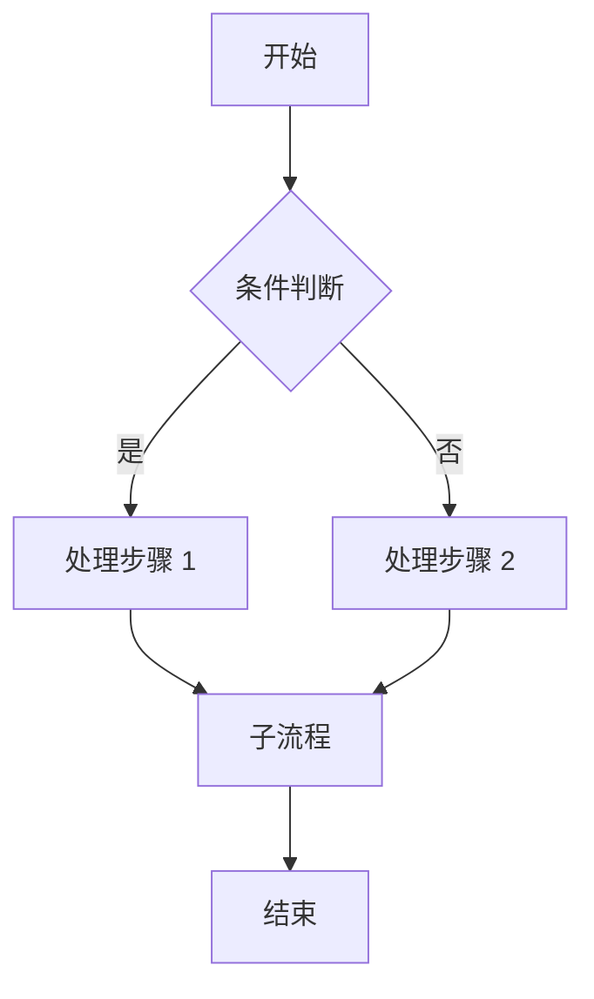
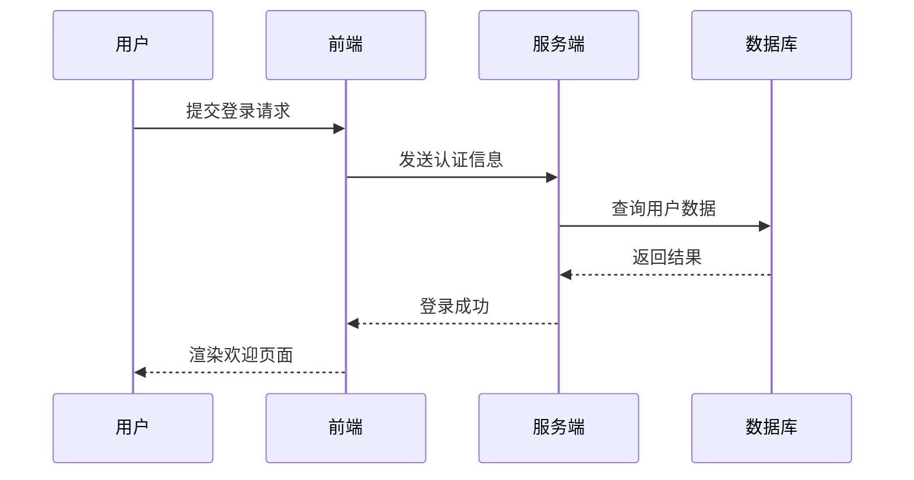
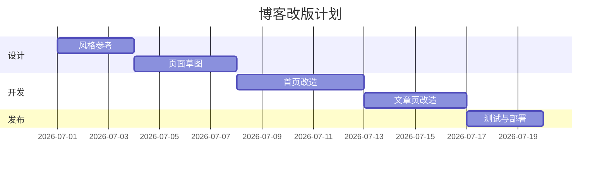
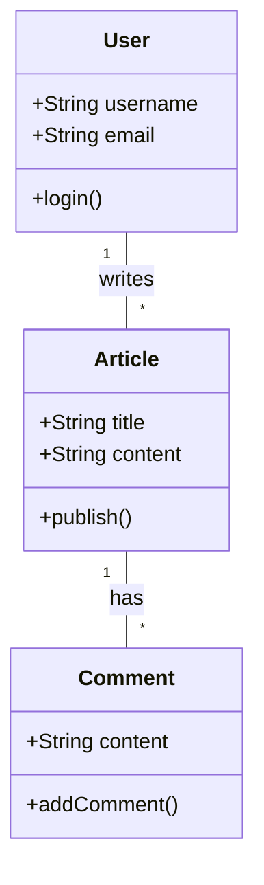
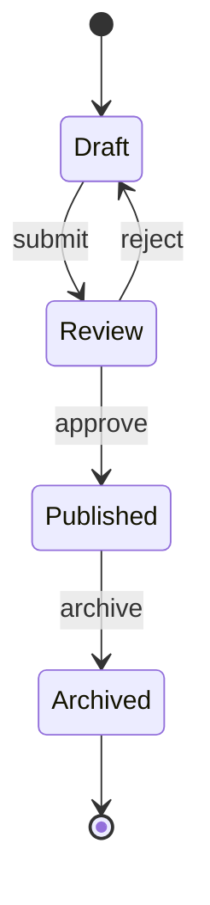

# Markdown 与 Mermaid 图表完整指南

这篇文章演示如何在 Markdown 文档里插入 Mermaid 图表，包括流程图、时序图、甘特图、类图和状态图。

## 流程图

流程图适合表示业务流程或算法步骤。

## 时序图

时序图非常适合表达用户、前端、服务端和数据库之间的交互过程。

## 甘特图

如果你想在文档里说明项目排期，甘特图会非常直观。

## 类图

类图适合说明系统里实体之间的结构关系。

## 状态图

状态图适合描述一篇文章从草稿到发布再到归档的变化过程。

## 总结

Mermaid 最大的好处是写法轻量、可维护性高，非常适合技术博客、项目文档和知识库。只要在 Markdown 代码块中声明 `mermaid`，就能把文本描述转换成结构清晰的图表。
